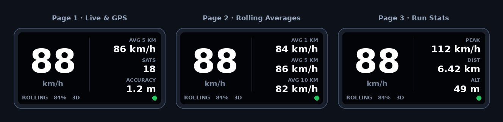

# DragyDash ESP32

[](https://github.com/jremick/dragy-dash-esp32/actions/workflows/ci.yml)
[](https://github.com/jremick/dragy-dash-esp32/actions/workflows/codeql.yml)
[](LICENSE)


Standalone, open-source **LilyGO T-Display-S3** firmware for showing live **Dragy Pro** speed, rolling averages, and GNSS quality over Bluetooth LE — turn a ~$20 pocket display into a dedicated, zero-phone cockpit HUD.

> **Unofficial project:** DragyDash ESP32 is not affiliated with, endorsed by, or supported by Dragy or LilyGO. Dragy BLE behavior is based on limited hands-on testing and may vary by device or firmware version.



## Why DragyDash ESP32?

- **Dedicated ~$20 hardware HUD:** Boots in seconds, connects straight to your Dragy Pro over BLE, and runs without draining your phone or fighting app switchers.
- **Glanceable driver-first UI:** Huge live speed on every page, color-coded GPS quality dot, and 3 button-paginated telemetry views — zero menus or distractions.
- **Metric (`km/h`) & Imperial (`mph`) builds:** Clean compile-time unit variants with zero settings-screen clutter.
- **Browser-flashable:** Includes an **ESP Web Tools** GitHub Pages flasher workflow so you can flash prebuilt Metric or Imperial binaries directly from Chrome or Edge.
- **Hardened embedded architecture:** Pure C++17 unit-tested `dragy_core` library, zero-heap 16 km circular ring buffer for O(1) rolling averages, FreeRTOS queue isolation between NimBLE 2.x callbacks and UI rendering, non-blocking BLE scanning, and NVS persistence for brightness and active page.

## DragyDash Ecosystem

| Project | Target | Best For |
| :--- | :--- | :--- |
| **[dragy-dash-esp32](https://github.com/jremick/dragy-dash-esp32)** *(this repo)* | LilyGO T-Display-S3 (ESP32-S3) | Dedicated ~$20 standalone hardware HUD — no phone required |
| **[dragy-dash](https://github.com/jremick/dragy-dash)** | iPhone (iOS 18+, Swift 6) | Full iOS cockpit dashboard, Dynamic Island Live Activity, launch timing, and CSV export |

## Display Pages

Available in **Metric** (`lilygo_t_display_s3`) and **Imperial** (`lilygo_t_display_s3_imperial`):

- **Page 1:** live speed, `5 km` (`3 mi`) rolling average, satellites, horizontal accuracy (`m` / `ft`).
- **Page 2:** live speed, `1 / 5 / 10 km` (`1 / 3 / 5 mi`) rolling averages.
- **Page 3:** live speed, peak speed, distance (`km` / `mi`), altitude (`m` / `ft`).

The firmware deliberately omits 0-60/0-100 timing, G-force gauges, Wi-Fi, SD card logging, and settings screens to stay fast and distraction-free.

## Controls

- **Quick left button tap:** previous page (saved to NVS).
- **Quick right button tap:** next page (saved to NVS).
- **Long left button hold:** reset in-memory stats (averages, peak speed, distance).
- **Long right button hold:** disconnect & pause BLE scanning; long right again resumes scanning.
- **Hold both buttons:** cycle display brightness (`DIM` / `MID` / `HIGH`, saved to NVS).

Run stats are RAM-only and clear on power cycle; only active page and brightness are persisted.

## Hardware & Bill of Materials

| Part | Details | Notes |
| :--- | :--- | :--- |
| **Board** | LilyGO T-Display-S3 (ESP32-S3, ST7789 170x320) | Non-touch or touch variants both work (controls use physical GPIO 0 / 14 buttons) |
| **Cable** | Right-angle USB-C power/data cable | Display rotates 180° (`setRotation(3)`) for clean cable routing |
| **Telemetry Source** | Dragy Pro (`DRG70-*`, service `FD00`) | Tested with Dragy Pro; other Dragy revisions welcome via [Hardware Reports](https://github.com/jremick/dragy-dash-esp32/issues/new?template=hardware_compatibility.yml) |

Pin assumptions are documented in [docs/HARDWARE.md](docs/HARDWARE.md).

## Quick Start: Build, Test, & Flash

### Option A: Browser Flasher (Prebuilt Releases)

Once a release is published with GitHub Pages enabled (`web-flasher/`), open the project's GitHub Pages URL in Chrome or Edge, choose **Metric (`km/h`)** or **Imperial (`mph`)**, connect your LilyGO T-Display-S3 over USB-C, and click **Install**.

### Option B: Build from Source with PlatformIO

Requirements: Python 3 and PlatformIO Core.

```bash
git clone https://github.com/jremick/dragy-dash-esp32.git
cd dragy-dash-esp32
python3 -m venv .venv
.venv/bin/python -m pip install --upgrade platformio

# Run host-side C++17 unit tests (dragy_core)
.venv/bin/pio test -e native

# Build Metric (km/h) firmware
.venv/bin/pio run -e lilygo_t_display_s3

# Or build Imperial (mph) firmware
.venv/bin/pio run -e lilygo_t_display_s3_imperial
```

Confirm your serial port before flashing:

```bash
.venv/bin/pio device list
.venv/bin/pio run -e lilygo_t_display_s3 --target upload --upload-port <PORT>
.venv/bin/pio device monitor --port <PORT> --baud 115200
```

See [docs/BUILD_AND_FLASH.md](docs/BUILD_AND_FLASH.md) for full flashing details.

## Architecture

- `lib/dragy_core/`: Pure C++17 library (zero Arduino dependencies) containing UBX `NAV-PVT` parsing, checksum-hardened stream reassembly, `FD03` handshake & `FD04` battery decoding, stationary hysteresis filtering, device-name redaction, and the fixed-RAM 16 km ring-buffer rolling-average tracker.
- `test/test_dragy_core/`: Native Unity unit tests executed in CI on every commit.
- `src/main.cpp`: Non-blocking NimBLE 2.x client, FreeRTOS packet queue bridging BLE callbacks to `loop()`, NVS preferences, debounced physical button handling, and region-cached ST7789 display rendering.
- `web-flasher/`: ESP Web Tools static browser flasher page.

## Documentation

- [Firmware behavior](docs/FIRMWARE_BEHAVIOR.md)
- [Hardware assumptions](docs/HARDWARE.md)
- [Build and flash commands](docs/BUILD_AND_FLASH.md)
- [Dragy BLE protocol notes](docs/DRAGY_PROTOCOL.md)

## Runtime Expectations

The ESP32 connects as a BLE central. If the official Dragy app or the companion [iOS DragyDash app](https://github.com/jremick/dragy-dash) is already connected, the Dragy may reject or stall the ESP32 connection (`BUSY?` or `STREAM`).

## Safety & Privacy

Do not interact with the display while driving. Mount the display securely, obey local road laws, and never rely on experimental firmware as your sole speedometer or compliance instrument.

Serial logs redact `DRG*-` device suffixes by default (`DRG70-******`). Never post raw BLE captures, full Dragy serial IDs, or route traces in public issues. See [SECURITY.md](SECURITY.md) and [CONTRIBUTING.md](CONTRIBUTING.md).

## License

[Apache License 2.0](LICENSE).
